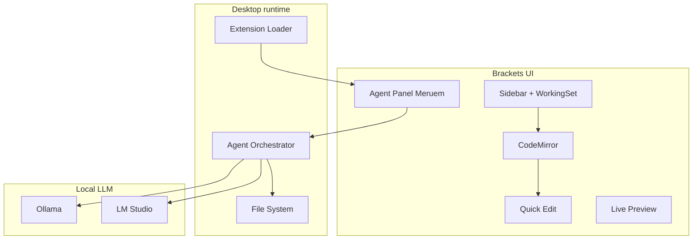

# Meruem — Brackets boosté à l’IA

Produit : **Meruem**  
Positionnement : *l’ancien Brackets, reconnaissable — cette fois avec des capacités d’IDE moderne et des agents IA.*

Ce n’est **pas** un clone VS Code / Cursor. L’UI, la logique et les workflows Brackets restent la base.

---

## 1. Vision produit

| Garder (ADN Brackets) | Ajouter (puissance moderne) |
|---|---|
| Layout sidebar + working set + thèmes | Agents IA (chat, tools, patches) |
| Quick Edit / outils inline | LSP multi-langage renforcé |
| Live Preview | Terminal, Git, recherche solide |
| CodeMirror comme éditeur | Perf / tooling modernisés |
| Système d’extensions Brackets | LLM **local-first** (Ollama, LM Studio, etc.) |
| Sensation « éditeur web Adobe » | Branding Meruem (`APP_NAME`, icônes, about) |

Phrase de positionnement :

> **Meruem = Brackets, reconnaissable, boosté à l’IA.**

---

## 2. Décision fondation (tranchée)

### Choix retenu

**Évoluer ce dépôt Brackets in-place** (`src/`, styles, CodeMirror, extensions).

- Runtime desktop : moderniser le shell (Electron ou `brackets-shell` maintenu) **sans changer le visage** de l’app.
- Éditeur : **CodeMirror** (garder l’intégration actuelle ; migration progressive vers CodeMirror 6 en coulisse si besoin, UI Brackets préservée).
- Agent IA : module / extension **native Brackets** (panneau et commandes au style Brackets, pas sidebar type Cursor).
- LLM : API **OpenAI-compatible en local** en premier (Ollama `:11434`, LM Studio `:1234`), cloud optionnel plus tard.

### Explicitement abandonné

- Greenfield Electron + React + **Monaco** sous `meruem/` — **supprimé**.
- Recopier le chrome / la UX VS Code.
- Fork Code-OSS comme base produit.

---

## 3. MVP agents (« Agent Companion v0 »)

Un agent conversationnel **dans l’UI Brackets**, capable de lire le projet, proposer des changements, avec validation humaine.

### Inclus

1. Branding Meruem sur Brackets (titre, about, strings via `{APP_NAME}`).
2. Panneau / panneau latéral Agent au style Brackets (pas un layout VS Code).
3. Tools : `list_dir`, `read_file`, `search_text`, `write_file` / patch, contexte éditeur (fichier actif, sélection).
4. Review Accept / Reject avant écriture disque.
5. Settings LLM locaux : provider Ollama | LM Studio | custom (base URL + modèle).
6. Règles projet optionnelles : `.meruem/rules.md`.

### Hors MVP

- Multi-agents parallèles type Composer Cursor  
- Embeddings / index vectoriel  
- Marketplace VS Code  
- Remplacement de CodeMirror par Monaco  
- Refonte visuelle « AI IDE »

### Critères de succès

- Un utilisateur de Brackets reconnaît immédiatement l’interface.
- Ouvrir un dossier, éditer avec CodeMirror comme avant.
- Prompt local (Ollama/LM Studio) → tools → patch → Accept → fichier modifié.
- Aucun secret / clé cloud requis pour le chemin local.

---

## 4. Architecture cible



### Principes

- **UI = Brackets** (`src/styles`, `htmlContent`, menus, thèmes).
- **Agent** = extension default ou module `src/extensions/default/MeruemAgent/` (+ domaine Node si besoin).
- **Patches** toujours prévisualisés avant écriture.
- **Local-first** : pas de dépendance cloud pour développer / tester.

### Emplacement code

```
src/
  extensions/default/MeruemAgent/   # panneau + commandes (scaffold Phase 1)
shell/                              # Electron appshell pour lancer src/
scripts/setup-meruem.ps1            # setup Windows one-shot
docs/MERUEM.md                      # ce document
```

Raccourci : **Affichage → Meruem Agent** (`Ctrl+Shift+M`).

Le dossier racine `meruem/` (Monaco) **n’existe plus**.

---

## 5. LLM local (Ollama / LM Studio)

| Provider | Base URL typique | Notes |
|---|---|---|
| Ollama | `http://127.0.0.1:11434/v1` | `ollama serve` + `ollama pull <model>` |
| LM Studio | `http://127.0.0.1:1234/v1` | Activer le serveur local OpenAI-compatible |
| Custom | configurable | Tout serveur `/v1/chat/completions` |

Présets dans les préférences Meruem : provider → URL / apiKey factice / modèle.

---

## 6. Plan par phases

### Phase 0 — Identité Meruem sur Brackets

- Renommer produit (config, strings, about, icône).
- S’assurer que l’app tourne (shell + `src/`) sous le nom Meruem.
- Documenter build / run Windows.

### Phase 1 — Agent Companion dans Brackets

- Extension `MeruemAgent` : panneau chat style Brackets.
- Client OpenAI-compatible (local).
- Tools FS + contexte éditeur + Accept/Reject.
- Préférences Ollama / LM Studio.

### Phase 2 — Capacités IDE (sans changer le look)

- Renforcer LSP via `src/languageTools`.
- Terminal / Git basiques pour le contexte agent.
- Live Preview conservé et soigné.
- Migration progressive CodeMirror 6 **si** gain réel, UI inchangée.

### Phase 3 — Durcissement

- Modes Ask vs Agent, règles projet riches.
- Packaging / auto-update.
- Perf grands projets.

---

## 7. Charte visuelle (verrouillée)

Voir [MERUEM_BRAND.md](MERUEM_BRAND.md).

- Accent `#2F8F84`, spark IA `#E8A23A`, fond `#1A1F28`
- Icône : `src/styles/images/meruem_icon.svg`
- Config : `app_title` / `app_name_about` = Meruem ; `package.json` name = Meruem

---

## 8. Runbook Windows

### Setup one-shot

```powershell
cd G:\brackets
npm run setup
# → scripts/setup-meruem.ps1 (submodules, deps, thirdparty, AMD packs, extensions, shell)
```

### Prérequis (manuel si besoin)

| Élément | Commande / note |
|---|---|
| Submodules | `git submodule update --init --recursive` |
| Deps racine | `npm install --ignore-scripts` puis copie CodeMirror / thirdparty (voir script) |
| Deps `src/` | `npm --prefix src install --production --ignore-scripts` |
| Extensions défaut | `JavaScriptCodeHints` + `brackets-eslint` (`npm install` dans chaque dossier) |
| Shell Electron | `npm --prefix shell install` |

> Le `zlib` npm historique a été retiré de `package.json` (incompatible Node moderne).  
> Le `postinstall` Grunt qui appelle l’ancien npm 3.x embarqué échoue sur Node 24 — utiliser `npm run setup`.

### Lancer Meruem

```powershell
cd G:\brackets
npm run dev
# équivalent : npm --prefix shell start
```

Le shell Electron (`shell/`) injecte une API `appshell` compatible Brackets (fs, dialogs, support directory) et charge `src/index.html?hasNativeMenus=false` pour conserver les menus HTML Brackets.

### Statut Phase 0 (vérifié)

- Titre fenêtre / about : **Meruem**
- Sidebar + working set + éditeur CodeMirror OK (`samples/fr/Premiers pas`)
- `inBrowser: false`, `appshell` présent

### Limites actuelles du shell

- Domaines Node Brackets (`getNodeState`) pas encore branchés → watchers FS / ClientInfo / language tools limités
- Live Preview avancé peut nécessiter le domaine Node (Phase 2)
- Phase 0 atteinte : UI Meruem/Brackets reconnaissable, ouvrir un dossier, éditer

---

## 9. Ordre de travail

1. ~~Supprimer Monaco (`meruem/`)~~ — fait.
2. ~~Phase 0 branding + run~~ — fait.
3. Phase 1 : extension `MeruemAgent` — panneau, LLM local, tools `list_dir` / `read_file` / `search_text` / `write_file` + Accept/Reject, règles `.meruem/rules.md`.
4. Phase 2 : domaines Node, LSP, terminal / Git.

---

## 10. Synthèse

1. **Fondation** : Brackets in-place + CodeMirror + UI Brackets.  
2. **IA** : agent intégré, local-first (Ollama / LM Studio).  
3. **Non-but** : ressembler à VS Code / Cursor ; Monaco abandonné.  
4. **Marque** : Meruem teal + spark ambre — voir MERUEM_BRAND.md.
